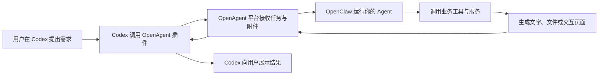

# OpenAgent 工作原理与开发指南

组长说的是整体流程。根据 OpenAgent 官方开发文档：**我们要开发的是运行在 OpenAgent 平台中的专业 Agent，用户通过 Codex 调用它，平台底层使用 OpenClaw 执行任务。** 这条路线已经有明确的开发规范。[官方开发文档](https://openagent.org/docs/program)

## 一、各个部分分别负责什么

| 部分 | 作用 |
|---|---|
| **Codex** | 用户交流入口，理解需求，调用专业 Agent，向用户展示结果 |
| **OpenAgent 插件及平台** | 发现和调用 Agent，传递任务与附件，返回执行结果 |
| **OpenClaw** | Agent 的运行环境，让模型按照业务规则执行任务、调用工具 |
| **你开发的 Agent** | 提供具体业务能力，例如推荐 LUT、处理照片、生成预览和导出文件 |

可以把调用过程理解为：



这里的“Codex 把信息传给 OpenClaw”，具体是通过插件和平台接口完成调用。

## 二、以 LUT 项目为例

1. **用户提出任务**  
   在 Codex 上传照片，说：“把这组照片调成自然的日系风格，保留肤色。”

2. **Codex 整理并发送任务**  
   Codex 选择你的 LUT Agent，将要求和附件一起交给 OpenAgent。远端 Agent **不会自动看到完整的 Codex 对话，也不能直接读取用户电脑上的文件**，所需背景和图片必须明确传入。[插件调用规范](https://github.com/openagent-org/codex-plugin/blob/rel/codex/skills/openagent-run-agent/SKILL.md)

3. **OpenClaw 执行业务流程**  
   你的 Agent 根据规则分析需求，调用图片分析、LUT 检索、预览渲染等工具。模型负责理解和选择步骤，实际调色由图片处理程序完成。

4. **返回可用结果**  
   返回推荐理由、预览图、处理后的照片，或者包含照片画布和风格选择器的交互页面。OpenAgent 支持文字、文件和 WebUI，因此我们已经做的前端可以继续作为结果查看与调整界面。[输入、文件与 WebUI 规范](https://openagent.org/docs/io-and-webui)

5. **用户继续调整**  
   用户说：“第二张再暖一点。”Codex 携带对应的 Agent 会话信息继续调用。照片、参数和结果之间的关联，需要我们的业务程序维护。

**因此，开发重点会调整为：业务能力 + Agent 规则 + 可选的交互页面。** 对 LUT 项目来说，核心仍是优质 LUT、推荐能力和真实调色效果；Codex 承担主要的对话入口。

## 三、新开对话开发其他 Agent

官方提供了专门的开发入口：

1. 在 OpenAgent 开发者页面创建 Agent 草稿。
2. 进入该版本的工作区，点击 **Build with local Agent**。
3. 将网站生成的**完整提示词原样复制**到新的 Codex 对话。它包含开发 Skill 地址，以及当前 Agent 和版本的标识。
4. 在这段官方提示词后面，追加你的业务要求。

这样，新对话能知道具体开发哪个 Agent、哪个版本，并按照平台流程进入开发环境。[官方开发入口说明](https://openagent.org/docs/local-agent)

可以直接追加下面这份模板：

```text
我要开发一个发布到 OpenAgent 的专业 Agent，请结合上面的官方开发提示词完成开发。

Agent 名称：
【填写暂定名称】

目标用户：
【谁会使用它】

主要需求：
【用户希望完成什么任务】

典型用户指令：
【写 2～3 句用户会在 Codex 中输入的话】

输入：
【文字、图片、PDF、表格或其他文件，以及必要参数】

输出：
【文字答复、处理后的文件、可下载结果或交互页面】

第一版范围：
【先实现最重要的一条完整流程】

使用方式：
用户在 Codex 中通过 OpenAgent 调用这个 Agent，
由平台中的 OpenClaw 执行业务，结果返回 Codex。
如果需要交互页面，按照平台 WebUI 规范实现。

开发要求：
1. 先读取官方提示词指定的 Skill，核对当前平台规范和目标版本。
2. 先跑通“接收真实输入 → 执行业务 → 返回真实结果”的最小流程。
3. 将业务规则、Skills、工具和必要服务按平台规范组织；
   远端业务实现放在 /oasn 下，并确保正式调用入口 main 能完成任务。
4. 根据任务需要增加文件处理和 WebUI。
5. 分别验证开发环境 WebChat 和正式平台调用，
   明确记录已经验证的能力与尚未完成的部分。
6. 使用 Git 管理代码，提交说明使用中文。
```

## 四、调用 Agent 与开发 Agent 的区别

**安装 OpenAgent 插件是获得“调用别人 Agent”的能力；开发自己的 Agent 则需要创建草稿、实现业务、测试、发布并上线。** 官方文档也明确区分“发布版本”和“上线”，发布后的版本默认处于离线状态。[开发与上线流程](https://openagent.org/docs)
